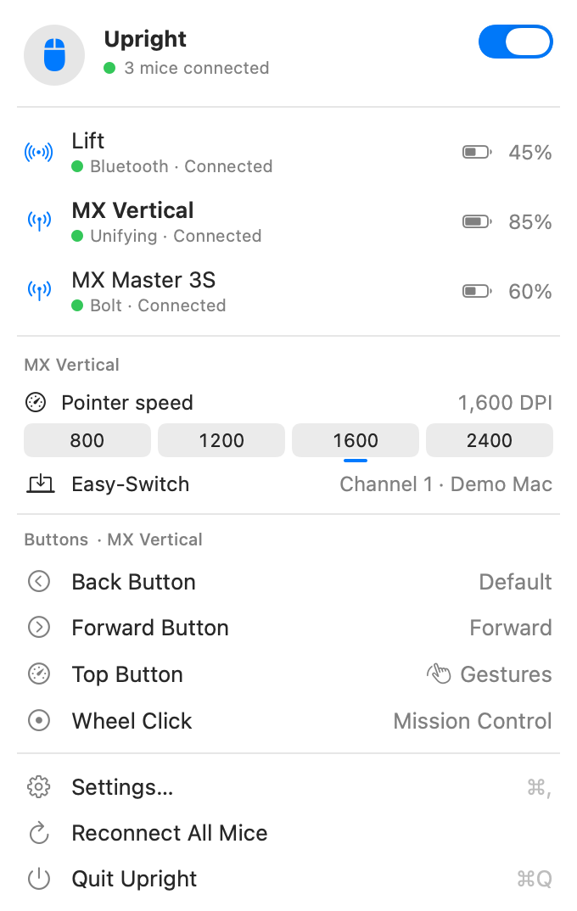
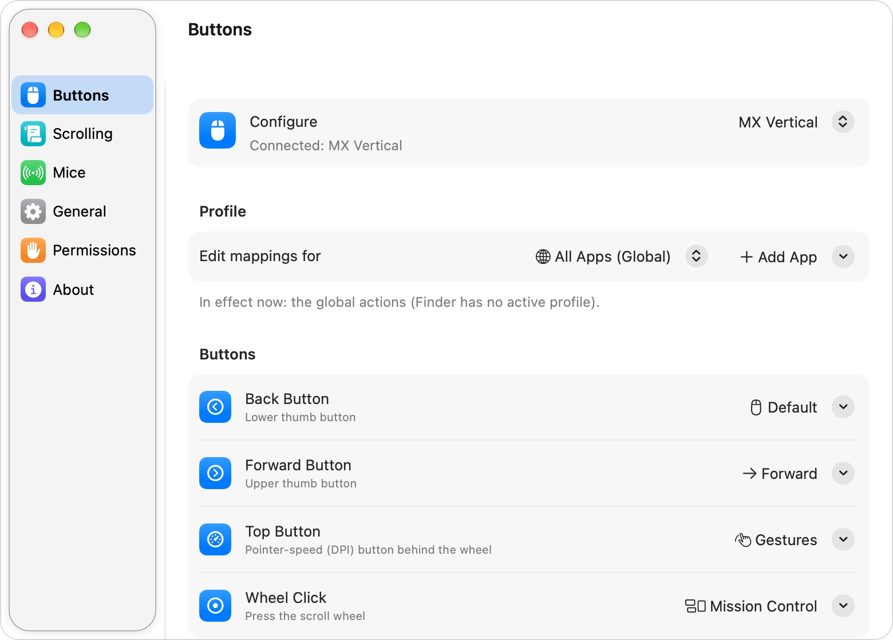

# Upright

**Open-source button remapping for Logitech mice on macOS, without Logi Options+.**

**Website:** [upright.hellobasalt.dev](https://upright.hellobasalt.dev/) · [MX Vertical on Mac](https://upright.hellobasalt.dev/mx-vertical) · [Download](https://github.com/dpdev69/upright/releases/latest)

Upright is a small native SwiftUI menu-bar app. **It remaps Logitech mice over HID++**: the
thumb buttons, the top (DPI) button, the wheel click and any other button a mouse lets software
take over. It also adds pointer-speed, scrolling and battery features. It talks to the mouse
directly over the publicly documented **HID++ 2.0** protocol, the same approach used by Solaar,
LogiOps and libratbag. It doesn't use a kernel extension or a background daemon, and it doesn't
include any Logitech software.

Upright works with any Logitech HID++ 2.0 mouse that exposes programmable buttons
(`REPROG_CONTROLS_V4`), and with **several mice at once**, over any mix of USB cable, Bluetooth
and Unifying, Bolt or Nano receivers. It was built and tested on the **MX Vertical**, which is the
only model verified on real hardware. Every other model is built from published device data and
tested against Upright's mouse simulator only. See [Supported devices](#supported-devices).

<p>
  
  
</p>

*Both pictures are rendered by [Demo Mode](#demo-mode) with simulated mice (an MX Vertical, an
MX Master 3S and a Lift, with made-up names and batteries). They show the real interface, not
real hardware.*

## Features

- **Remap buttons.** Back, Forward, the Top (DPI) button, the Wheel Click and any other
  divertable button a mouse reports. Actions:
  - built-in system actions: Mission Control, App Exposé, Show Desktop, switching Spaces,
    Back/Forward, tabs, media keys, Spotlight, screenshots, Lock Screen,
    Copy/Paste/Undo/Redo, middle click and mouse buttons 4/5
  - any recorded keyboard shortcut
  - **Open App**, **Open URL** and **Run Shortcut** (a Shortcuts.app shortcut, by name)
  - **Pointer speed**: cycle through your presets, or jump to a fixed DPI (mice with
    `ADJUSTABLE_DPI`, `0x2201`, only)
  - **Easy-Switch**: move the mouse to another paired computer (mice that report the Easy-Switch
    feature)
  - **Do Nothing**, or **Default** to leave the button to the mouse
- **Several mice at once.** Every connected mouse is listed in the menu-bar panel and in
  **Settings → Mice**, with its connection, state and battery. See
  [Using several mice](#using-several-mice).
- **Per-model mappings.** Each mouse model has its own button setup and its own per-app profiles.
  Choose which model you are editing with the **Configure** picker in **Settings → Buttons**. You
  can set up a catalog model before you own it, copy a setup from another model, or use one setup
  for all your mice.
- **Gestures.** Set a button to *Gestures* to get five actions: a click, plus hold and move up,
  down, left or right. The mouse reports raw movement while the button is held, so the cursor
  doesn't move. If a button can't report raw movement, Upright falls back to watching the
  cursor, which does move during the gesture (the Buttons pane says so).
- **Per-app profiles.** Keep a global table and add apps (by bundle ID) that override single
  buttons while they are frontmost. A button without an override uses the global action, and
  an override can also hand a button back to the mouse in that app.
- **Per-mouse settings.** Give a mouse a nickname, switch **Remap this mouse** off to hand all its
  buttons back, and keep its pointer speed. Upright remembers these for each physical mouse and
  lists mice it has seen before under **Not Connected**.
- **Pointer speed (DPI).** Set the speed with a slider, keep a list of presets, and pick a
  speed to apply whenever a mouse reconnects. Speeds snap to what the mouse supports. Mice without
  `0x2201` don't get pointer-speed controls.
- **Device info.** Firmware, serial number, battery, connection type, the Easy-Switch channel
  (with host names when the mouse stores them), the HID++ feature table and the control list, plus
  a **Copy Device Report** button for bug reports and new-model requests.
- **Battery.** Reads the level when a mouse connects and about every 10 minutes. Mice that
  report only a coarse level (critical, low, good, full) show an approximate value such as
  "~50%". Low-battery notifications at 15% and 5% per mouse (on by default; macOS asks for
  notification permission the first time), and an optional percentage next to the menu-bar icon
  (with several mice it shows the lowest).
- **Scrolling.** Reverse the mouse wheel independently of the trackpad, change the speed
  (0.5x to 3x), and try the experimental smooth scrolling. All off by default. These settings
  apply to **every** mouse wheel; see [Scrolling](#scrolling).
- **Export and import** of all mappings and profiles, for every model, as a JSON file.
- **First-run onboarding** for new installs: connect, allow Accessibility, choose a setup.
- **Robust reconnection.** Button diversion is reapplied after a mouse sleeps or is switched
  off and on, after the Mac wakes, and when a receiver or cable is replugged. Each mouse is
  retried on its own with backoff, so a sleeping mouse doesn't hold up another one.
- **Leaves nothing behind.** Buttons are only *temporarily* diverted. When Upright quits it
  hands them back, and power-cycling a mouse always restores factory behavior. Nothing is
  written to a mouse's memory.
- **Demo Mode.** `--demo` runs the real interface against simulated mice, and
  `--export-snapshots` renders it to PNG files. See [Demo Mode](#demo-mode).
- **Feels native.** A menu-bar panel, a System Settings-style window, SF Symbols, light and
  dark mode. Open at Login uses `SMAppService`.
- **Explains permissions.** It shows what it needs and why. Until Accessibility is granted,
  mappings that need it are not applied and the buttons keep their normal behavior.

### Defaults

A fresh install **remaps nothing**: every button keeps its native behavior (for the MX Vertical,
Back and Forward are mouse buttons 4 and 5, and the top button cycles DPI). Pick actions in
**Settings → Buttons**, or accept the suggested setup for your model during onboarding.

If you used an earlier version, your saved mappings are migrated into the MX Vertical's setup and
kept. Anything Upright can't read is backed up in its preferences instead of being thrown away.
See the [changelog](CHANGELOG.md) for the details of the migration and of going back to an older
build.

## Supported devices

> **Only the MX Vertical has been tested on real hardware.** Every other model below is built from
> published device data (Solaar and libratbag dumps) and has been tested only against Upright's
> mouse simulator. "Published data" means exactly that: it is expected to work, and **unverified
> on hardware**. If you try one, please report what you see (see [Report your
> mouse](#report-your-mouse)).

The table below is derived from the model catalog,
[`DeviceCatalog.swift`](UprightKit/Sources/UprightKit/Device/DeviceCatalog.swift). The same data
with every product ID is in [docs/DEVICES.md](docs/DEVICES.md).

| Model | Connections in the catalog | Remappable controls in the catalog | Status |
| --- | --- | --- | --- |
| MX Vertical | USB cable, Bluetooth, Unifying receiver | Back, Forward, Top (DPI) button, Wheel click | Verified on hardware |
| MX Master | Bluetooth, Unifying / Nano receiver | Back, Forward, Gesture button, SmartShift button, Wheel click | Published data (untested on hardware) |
| MX Master 2S | Bluetooth, Unifying / Nano receiver | Back, Forward, Gesture button, SmartShift button, Wheel click | Published data (untested on hardware) |
| MX Master 3 | Bluetooth, Unifying / Nano receiver | Back, Forward, Gesture button, SmartShift button, Wheel click | Published data (untested on hardware) |
| MX Master 3 for Business | Bluetooth, Bolt receiver | Back, Forward, Gesture button, SmartShift button, Wheel click | Published data (untested on hardware) |
| MX Master 3S | Bluetooth, Bolt receiver | Back, Forward, Gesture button, SmartShift button, Wheel click | Published data (untested on hardware) |
| MX Master 4 | Bluetooth | Back, Forward, Gesture button, Haptic Sense button, SmartShift button, Wheel click | Published data (untested on hardware) |
| MX Anywhere 2 | Bluetooth, Unifying / Nano receiver | Back, Forward, Wheel click, Tilt left, Tilt right | Published data (untested on hardware) |
| MX Anywhere 2S | Bluetooth, Unifying / Nano receiver | Back, Forward, Wheel click, Tilt left, Tilt right | Published data (untested on hardware) |
| MX Anywhere 3 | Bluetooth, Unifying / Nano receiver | Back, Forward, SmartShift button, Wheel click | Published data (untested on hardware) |
| MX Anywhere 3 for Business | Bluetooth, Bolt receiver | Back, Forward, SmartShift button, Wheel click | Published data (untested on hardware) |
| MX Ergo | Bluetooth, Unifying / Nano receiver | Back, Forward, Precision button (DPI), Wheel click, Tilt left, Tilt right | Published data (untested on hardware) |
| Lift | Bluetooth, Bolt receiver | Back, Forward, Top (DPI) button, Wheel click | Published data (untested on hardware) |
| Lift for Business | Bluetooth, Bolt receiver | Back, Forward, Top (DPI) button, Wheel click | Published data (untested on hardware) |
| M720 Triathlon | Bluetooth, Unifying / Nano receiver | Back, Forward, Gesture button (multi-platform), Wheel click, Tilt left, Tilt right | Published data (untested on hardware) |
| M585 / M590 | Bluetooth, Unifying / Nano receiver | Back, Forward, Wheel click, Tilt left, Tilt right | Published data (untested on hardware) |
| Signature M650 L | Bluetooth, Bolt receiver | Back, Forward, Wheel click | Published data (untested on hardware) |
| Signature M550 | Bluetooth, Bolt receiver | Wheel click | Published data (untested on hardware) |
| ERGO M575 | Bluetooth, Unifying / Nano receiver | Back, Forward, Wheel click | Published data (untested on hardware) |
| Marathon M705 | Unifying / Nano receiver | Back, Forward, Wheel click, Tilt left, Tilt right | Published data (untested on hardware) |
| Pebble M350 | Bluetooth, Unifying / Nano receiver | Wheel click | Published data (untested on hardware) |
| M510 (v2) | Unifying / Nano receiver | Back, Forward, Wheel click, Tilt left, Tilt right | Published data (untested on hardware) |
| M185 / M235 / M310 | Unifying / Nano receiver | Wheel click | Published data (untested on hardware) |

| Status | Meaning |
| --- | --- |
| **Verified on hardware** | Tested on a real mouse. Only the MX Vertical. |
| **Published data (untested on hardware)** | In the catalog, built from published dumps. Simulator-tested only. |
| **Untested** | Not in the catalog. Any other Logitech mouse that answers HID++ 2.0 and exposes programmable buttons is served too, but nothing is known about it. |

The catalog supplies names, control lists and suggested setups. Whether a mouse is served is
decided by what it answers (HID++ 2.0, a pointer, and `0x1B04` with at least one control Upright can
divert), not by its name or product ID. A mouse that doesn't qualify shows up under
**Settings → Mice → Other Logitech devices** with the reason, and keeps working as usual.
Keyboards are never opened. G-series and PRO gaming mice keep their buttons in onboard profiles
and are not expected to work.

### Receivers

| Receiver | Status |
| --- | --- |
| **Unifying** (`046D:C52B`, `C532`) | Supported. A mouse is found in any of the 6 slots. The MX Vertical is verified on hardware (1.0) behind one; other mice are unverified. |
| **Bolt** (`046D:C548`) | Implemented from Solaar's documentation and **simulator-tested only**. Not verified on a real Bolt receiver. The MX Vertical can't pair with Bolt. |
| **Nano** (12 product IDs, see [docs/DEVICES.md](docs/DEVICES.md#receivers)) | Opened and read with the Unifying pairing layout. **Unverified on hardware.** |
| **Lightspeed** (G and PRO mice) | **Never opened.** The mice behind Lightspeed receivers in the research data have no programmable-button feature (`0x1B04`), the `C53A` receiver also carries a PowerPlay chip, and Logitech G HUB owns them. Upright leaves them completely alone. |
| **27 MHz** (pre-Unifying, `C517`) | Never opened. Those devices speak HID++ 1.0 only. |

### Connections

| Connection | Status |
| --- | --- |
| USB cable | Supported. The MX Vertical (`046D:C08A`) is verified on hardware (1.0); other models are unverified. |
| Bluetooth | Best effort. Depends on macOS exposing the mouse's HID++ collection, and may need Input Monitoring. The MX Vertical (`046D:B020`) is the model it was built for; other models are unverified. |
| Receivers | See above. |

### Report your mouse

If you own a model other than the MX Vertical, you can help move it from "published data" to
"verified": use **Settings → Mice → Copy Device Report** while the mouse is connected, then quit
Upright and run `make probe ARGS=--all` (no button is diverted; Upright and the probe must not run
at the same time), then open an issue on GitHub with both
(see `.github/ISSUE_TEMPLATE`).

## Using several mice

You can connect any number of supported mice at the same time, over any mix of cable, Bluetooth
and receivers, including several mice on one receiver. Upright opens each one separately.

- **Each mouse is its own row** in the menu-bar panel and in **Settings → Mice**, with its own
  state, battery, pointer speed, nickname and **Remap this mouse** switch. A mouse that is asleep
  or isn't answering doesn't hold up the others.
- **Button mappings belong to the model, not to the unit.** Two MX Masters share one setup; an MX
  Master and an MX Vertical each have their own. When two or more units of a model are connected,
  the Buttons pane says "Applies to every <model>".
- **The same mouse over two links** (for example a mouse that is on its receiver and also on a
  cable) is recognized by its unit ID and listed once: one connection is used and the other is
  kept as a standby, so an action is never sent twice. This relies on the mouse reporting the same
  unit ID on both links, which is **not yet verified on hardware**.
- **The menu-bar panel's button summary, pointer speed and Easy-Switch sections** act on one
  mouse at a time and show its name in the section header: the mouse that last sent a button
  press, else the one selected in **Settings → Mice**, else the first connected.
- **Verification.** Multi-mouse behavior is covered by the simulator and by end-to-end tests with
  several simulated mice. Upright 1.0 was tested on hardware with a single MX Vertical; this
  multi-mouse build has not yet been run on real hardware. **Two real mice at once is unverified.**

## Requirements

- macOS 13 Ventura or later (Apple silicon or Intel)
- Xcode 15.3 or later to build (CI builds with Xcode 16.2)
- A Logitech mouse that speaks HID++ 2.0 with programmable buttons. The MX Vertical is the one
  verified on hardware; see [Supported devices](#supported-devices).

## Build and run

### Xcode

1. Open `Upright.xcodeproj`.
2. Select the **Upright** scheme and press **⌘R**.

The project is set to *Sign to Run Locally* (ad-hoc signing), so you don't need an Apple
Developer account or team. A mouse icon appears in the menu bar. On first launch the welcome
window opens.

### Command line

```bash
make test     # UprightKit unit tests (also run on Linux)
make app      # Release build, universal, ad-hoc signed with the hardened runtime
              #   → build/Build/Products/Release/Upright.app
make verify   # codesign --verify on the built app, and print its flags
make dmg      # …and package it as dist/Upright.dmg
make open     # build and launch
make probe    # talk to connected Logitech mice from the terminal (see below)
make snapshots # render the UI with simulated mice into media/snapshots/ (see Demo Mode)
make clean    # remove build/, dist/ and UprightKit/.build
```

`make app` wraps this command:

```bash
xcodebuild -project Upright.xcodeproj -scheme Upright -configuration Release \
  -derivedDataPath build CODE_SIGN_IDENTITY="-" CODE_SIGNING_REQUIRED=NO \
  ENABLE_HARDENED_RUNTIME=YES OTHER_CODE_SIGN_FLAGS="--options=runtime" \
  ARCHS="arm64 x86_64" ONLY_ACTIVE_ARCH=NO build
```

The app uses the **hardened runtime** and is not sandboxed (see [Permissions](#permissions)).

### GitHub Actions

`.github/workflows/build.yml` has three jobs:

- **core-tests** runs the UprightKit tests on Ubuntu 24.04 with Swift 6.0.
- **app** runs on `macos-15` with Xcode 16.2. It runs the tests again on macOS (which also
  covers the IOKit layer), builds the app with `make app`, checks the signature with
  `make verify` and packages `Upright-<version>.dmg` (or `Upright-<commit>.dmg` outside a
  release). The DMG is uploaded as a workflow artifact.
- **release** runs only for tags that start with `v`. It attaches the DMG to a GitHub release
  with generated notes.

For a tag such as `v1.1.0`, the **app** job fails unless the tag matches `MARKETING_VERSION` in
`project.pbxproj`.

By default the DMG is **unsigned** (ad-hoc). If the repository defines the secrets
`MACOS_CERTIFICATE_P12` and `MACOS_CERTIFICATE_PASSWORD`, the job also signs the app and DMG
with a Developer ID certificate. If notary credentials are set as well (an App Store Connect
API key as `NOTARY_KEY_ID`, `NOTARY_ISSUER_ID` and `NOTARY_KEY_P8`, or `APPLE_ID`,
`APPLE_TEAM_ID` and `APPLE_APP_PASSWORD`), it notarizes and staples the DMG and checks it with
`stapler validate` and `spctl`. Without those secrets, none of this runs. See
[docs/dev/RELEASING.md](docs/dev/RELEASING.md).

An ad-hoc DMG isn't notarized, so Gatekeeper blocks the first launch. Either right-click
`Upright.app` → **Open** → **Open**, or run:

```bash
xattr -dr com.apple.quarantine /Applications/Upright.app
```

## Permissions

| Permission | Needed for | When |
| --- | --- | --- |
| **Accessibility** | Posting the keyboard shortcuts, media keys and clicks your buttons are mapped to, and changing scrolling (it needs an event tap) | Whenever a mapping sends input or a scroll setting is on. Mission Control actions, Open App/URL, Run Shortcut, pointer speed, Easy-Switch and "Do Nothing" work without it. |
| **Input Monitoring** | Opening a mouse's HID++ interface | Only if macOS hides a mouse from Upright, which can happen over Bluetooth. Upright doesn't ask for it at launch. The Permissions pane and the menu-bar panel say so when it happens. |

- Upright never reads keystrokes. It only opens Logitech HID interfaces: the vendor usage pages
  `0xFF00` and `0xFF43` (receivers, cables and Bluetooth LE) and the mouse interface of Logitech
  mice, where Bluetooth mice carry HID++. Keyboards, Lightspeed receivers and other devices that
  Upright can't use are not opened, and it only posts the actions you assign. It never configures
  a mouse that doesn't answer as a supported pointer.
- Until Accessibility is granted, buttons with keyboard, media or click actions are **not
  diverted**, so they keep working as normal mouse buttons. The menu-bar panel and the Buttons
  pane show an **Allow…** button that opens the right System Settings page. The UI updates by
  itself once you flip the switch.
- **Rebuilds and updates.** macOS ties the Accessibility grant to the app's code signature. An
  ad-hoc build gets a new signature every time you rebuild, and an updated or moved copy can
  look the same. System Settings may then show Upright switched on, while macOS refuses the
  new copy. Upright detects this (it was trusted before and isn't now) and offers a
  **Reset Permission** button in Settings → Permissions and in the welcome window. It removes
  the old entry with `tccutil` and asks again. To do it by hand:

  ```bash
  tccutil reset Accessibility io.github.upright.Upright
  tccutil reset ListenEvent io.github.upright.Upright
  ```

- The app is not sandboxed, because posting synthetic input and opening HID devices requires
  that. It doesn't phone home or collect anything. **Run Shortcut** starts
  `/usr/bin/shortcuts`, and **Open App/URL** go through macOS.

## Scrolling

**Settings → Scrolling** applies to mouse wheels only. Trackpads and Magic Mouse send
continuous scroll events, and Upright never touches those.

- **Reverse** vertical and horizontal scrolling separately from the trackpad's Natural Scrolling.
- **Speed** multiplies the distance of each wheel step (0.5x to 3x).
- **Smooth scrolling** (experimental) turns each wheel step into a short eased glide.
- **Only while a Logitech mouse is connected** (on by default). macOS doesn't tell an event tap
  which mouse a scroll came from, so **these settings are global to every mouse wheel**, with
  no per-mouse or per-model setting. With this option on, Upright rewrites wheel events only
  while at least one supported Logitech mouse is connected, but it can't tell that mouse from
  another one: while one is connected, a third-party mouse wheel is changed too. With the option
  off, every mouse wheel is always changed.

This needs Accessibility. Without it, scrolling works as usual and the pane says why.

## Testing with real hardware

The core of Upright is unit-tested against simulated mice (see below). These steps verify the
real hardware path, and were written for the MX Vertical, the one model verified on hardware.
They work for any mouse; a model other than the MX Vertical is **unverified**, so a report of
what you see is valuable. If something fails, the output from step 1 and the log from step 6
make a great bug report.

1. **Probe from the terminal (no app needed).**

   ```bash
   make probe                 # or: swift run --package-path UprightKit upright-probe
   make probe ARGS=--all      # also read interfaces Upright doesn't use (read-only)
   make probe ARGS=--divert   # also divert every remappable button of every mouse and print events
   ```

   You should see each receiver or cable interface, then, for every mouse, a verdict such as
   `✓ MX Vertical: Upright supports this device` with each line prefixed by the mouse's label
   (for example `[MX Master 3S · Bolt slot 2]`), followed by the battery, firmware, serial
   number, pointer speed, Easy-Switch channels, the HID++ feature table and the control list. Remappable controls are marked with `*`, and controls that can
   report raw movement (needed for hold-and-move gestures) carry a `raw XY` flag. With
   `--divert`, pressing a thumb button prints `● Back Button (0x0053) pressed/released`
   instead of navigating, and **Ctrl-C** gives the buttons back. If nothing is found, click a
   mouse button to wake it. If macOS blocks access, allow your terminal app under Privacy &
   Security → Input Monitoring.
2. **Launch the app** (`make open` or ⌘R in Xcode). The menu-bar panel should show
   a row for each mouse with its connection (for example *Unifying · Connected*) and its battery level.
3. **Grant Accessibility** when asked. The orange callout disappears.
4. **Defaults.** On a fresh install, nothing is remapped. In Safari or Finder the thumb buttons
   still go back and forward as mouse buttons 4 and 5, and the top button still cycles DPI.
5. **Remap.** Open **Settings → Buttons**, choose your mouse in **Configure**, set *Top Button* to **Keyboard Shortcut…** and
   press e.g. ⇧⌘5. Pressing the top button should now open the screenshot toolbar. Set a button
   to **Default** to give it back to the mouse. For the top button, that brings back DPI
   cycling.
6. **Sleep and reconnects.** Watch **Settings → Mice → Activity** while you:
   - switch the mouse off and on (for a receiver, expect *Slot n link lost*, then *link restored* and
     *Reapplied configuration*),
   - put the Mac to sleep and wake it (expect *Mac woke up; reapplying button configuration*),
   - unplug and replug the receiver or cable.

   After each one, remapped buttons should still work. Turn on **Raw HID++ reports** to see
   every packet.
7. **Quit** Upright. The buttons should immediately behave like stock mouse buttons again.

Something not working? See [Troubleshooting](#troubleshooting). With several mice, repeat steps
4 to 7 for each one, and check that pressing a button on one mouse never triggers the other's
mapping.

### Demo Mode

Demo Mode runs the real interface against **simulated** mice, so you can look around (or make
screenshots) without a mouse, a receiver or any permission:

```bash
make app
build/Build/Products/Release/Upright.app/Contents/MacOS/Upright --demo
```

It simulates an MX Vertical on a Unifying receiver, an MX Master 3S on a Bolt receiver and a Lift
over Bluetooth. Every name, serial number and battery level is made up. It never opens IOKit,
installs event taps, asks for permissions or posts input, and it keeps its own preferences
(`io.github.upright.Upright.demo`, cleared at each start), so it never touches your real settings
and can run next to a normal Upright. Because the mice are simulated, this shows the interface, not
how any real model behaves.

`--export-snapshots <dir>` (which implies `--demo`) renders the interface offscreen into
`<dir>`, light and dark, then quits: one PNG per state plus a `manifest.json` with each image's
size and the rectangles of its named elements. `make snapshots` does this into `media/snapshots/`
(override the folder with `SNAPSHOTS=<dir>`). The pictures at the top of this page were made this
way.

### Automated tests

`UprightKit` contains every protocol, mapping, scrolling and battery decision and runs on any
platform with Swift 5.9+:

```bash
swift test --package-path UprightKit
```

The tests cover HID++ framing and response/error matching, control-table and event decoding,
mapping persistence and migration (schema v1, v2 and v3), profiles, gestures, scroll transforms,
battery alerts, the device catalog, interface classification and the configuration planner.
They also drive the hub (`HIDPPLink`) and its per-mouse `EndpointController`s end to end against
`UprightKit/Sources/UprightKit/Simulation`, a set of software mice and receivers that answer
HID++ the way published device dumps say real ones do (an MX Vertical, MX Master 3S, Lift, MX
Master 3, M720 Triathlon, MX Ergo, M185 family, a G502 Lightspeed, an MX Keys keyboard and more),
either directly or behind a Unifying or Bolt receiver slot. Those scenarios include receiver
slot discovery, several mice on one receiver and on several links, diversion, button events,
sleeping and waking, a mouse that shows up later, the `0x1D4B` reconnect event, Mac wake,
transport removal mid-press, retry with backoff, restore on quit and a randomized
fleet test. **Passing these tests says the logic is right for the simulated device; it doesn't
make a model verified on hardware.**

## Troubleshooting

**Upright says "Not connected" or can't find the mouse.**
Plug in the receiver or the USB cable, or pair over Bluetooth, then click a mouse button to
wake the mouse. Open Settings → Mice → Activity to see what Upright found. Use **Reconnect**
on the mouse's page, or **Reconnect All Mice** in the menu-bar panel, to make it look again.
Remember that the MX Vertical can't use a Bolt receiver, and that Lightspeed and 27 MHz
receivers are never opened. Run `make probe ARGS=--all` (see above): if the probe can't find the
mouse either, the problem is below Upright.

**My mouse isn't in the list, or is under "Other Logitech devices".**
Upright serves a mouse only if it answers HID++ 2.0 as a pointer and offers programmable
buttons (`0x1B04`). The reason is shown next to the device (for example "No programmable
buttons" or "Older HID++ 1.0 device"). Models in the catalog are
[unverified on hardware](#supported-devices) apart from the MX Vertical, so a catalogued
mouse can still turn out not to work: use **Copy Device Report** and open an issue.

**Two mice do the wrong thing, or one of them is ignored.**
Mappings belong to the model, so two mice of one model share a setup (see
[Using several mice](#using-several-mice)). Check that the **Configure** picker in Settings →
Buttons is on the model you mean, and that **Remap this mouse** is on in Settings → Mice. If
the same mouse is connected two ways, Upright uses one connection and shows the other as "also
on …".

**Bluetooth: the mouse is paired but Upright never sees HID++.**
macOS has to expose the mouse's HID++ collection to apps, and it sometimes doesn't. Check
Privacy & Security → Input Monitoring: if the Permissions pane shows Input Monitoring as
needed, allow Upright there and choose Reconnect. If the probe also fails over Bluetooth, use
the Unifying receiver or the USB cable instead.

**Accessibility looks switched on, but buttons don't remap.**
This is usually a stale grant after a rebuild, an update or moving the app. Open
Settings → Permissions and click **Reset Permission**, then allow Upright again. If the button
isn't there, run the `tccutil reset Accessibility io.github.upright.Upright` command above,
then relaunch Upright and allow it again. Also check that **Remap buttons** is on, and that
the frontmost app doesn't have a profile that overrides the button.

**A Mission Control, App Exposé or Show Desktop action does nothing.**
Upright starts these through macOS (`open -a "Mission Control"`). Try that command in Terminal.
If it works there, check Upright's Activity log. If not, assign a keyboard shortcut instead:
turn on the shortcut in System Settings → Keyboard → Keyboard Shortcuts → Mission Control and
record the same shortcut in Upright.

**Open at Login doesn't stick, or Upright isn't there after logging in.**
Upright must live in `/Applications` first. A copy run from `build/`, Downloads or a mounted
DMG breaks when it moves or is deleted. Move it to Applications, quit, launch it from there,
then turn Open at login on again. If macOS asks for approval, use **Open Login Items…** in the
General pane.

**Scrolling settings have no effect.**
Scrolling needs Accessibility. The Scrolling pane says "Accessibility access needed" when it is
missing, and "Paused until a Logitech mouse connects" when **Only while a Logitech mouse is
connected** is on and no mouse is connected. These settings apply to every mouse wheel. Trackpad and Magic Mouse scrolling is never
changed. If smooth scrolling feels wrong, turn it off; it is experimental.

**Gestures move the cursor.**
Your mouse didn't offer raw movement for that button (the probe doesn't mark it `raw XY`), so
Upright watches the cursor instead. Gestures still work, but the pointer moves while the
button is held. The Buttons pane shows a note when this applies. In this fallback Upright
watches the cursor, which isn't tied to any one mouse, so it can't attribute the movement to a
particular mouse.

**Another app is fighting over the buttons.**
Logi Options+, Logitech Options, Solaar and LogiOps also divert buttons. Only one can win.
Quit them (and remove them from your login items) while using Upright.

**Collect diagnostics.** Run `make probe ARGS=--all` and copy its output. Then open Settings →
Mice, use **Copy Device Report** for the mouse, and open its Activity log (turn on **Raw HID++
reports** if asked, reproduce the problem, and use **Copy**). Include them in a bug report (see
`.github/ISSUE_TEMPLATE`), together with the model, how many mice are connected and how.

## Architecture

```
┌──────────────────────────── Upright.app (SwiftUI, AppKit) ─────────────────────────────┐
│ MenuBarView · OnboardingView                                                           │
│ SettingsView (Buttons / Scrolling / Mice / General / Permissions / About)              │
│ AppModel ── per-model mappings + per-app profiles (MappingStore), per-mouse            │
│             preferences, remap switches, configuration planning, routing               │
│ AppSettings ── scroll, battery and pointer-speed preferences                           │
│ DeviceManager ── opens interfaces from a LinkSource (IOKit, or simulated in Demo Mode),│
│             sleep/wake observers, one record per mouse, status and activity log        │
│ SystemActionPerformer ── CGEvent keys, media keys, clicks, apps, URLs, Shortcuts       │
│ FrontmostAppMonitor · ScrollController (event tap) · BatteryNotifier                   │
│ PermissionsMonitor · LoginItemController (SMAppService) · DemoMode · SnapshotExporter  │
└────────────────────────────────────────────┬───────────────────────────────────────────┘
                                             │ compiled into the app from
┌───────────────────────────── UprightKit (Swift package) ───────────────────────────────┐
│ Platform/  HIDDeviceMonitor, IOKitHIDTransport (IOHIDManager, macOS only)              │
│ Device/    DeviceCatalog, ControlCatalog ── models, receivers, control names            │
│            InterfaceClassifier ── which HID interfaces to open, and as what             │
│            HIDPPLink ── one per opened interface: receiver slots or a direct mouse      │
│            EndpointController ── keeps ONE mouse configured (probe, retry, reconnect)   │
│            DeviceSession ── features, controls, diversion, events, device info          │
│            DeviceRegistry ── every mouse, its role, same-unit dedupe                     │
│            ConfigurationPlanner ── what each mouse should be doing                       │
│            DeviceIdentity (ModelKey, DeviceID), DevicePreferences, ReceiverDirectory     │
│ HIDPP/     HIDPPMessage, HIDPPClient (request/response matching, busy retry),          │
│            HIDPPDevice (root, feature set, name, battery), ReprogControls (0x1B04),    │
│            DeviceFeatures (firmware, DPI, Easy-Switch)                                 │
│ Mapping/   ButtonAction, SystemAction, KeyCombo, ButtonMappings, MappingProfiles,      │
│            MappingLibrary (schema v3, per model), MappingStore, GestureSet,            │
│            GestureRecognizer, RemapEngine (events carry their source mouse)            │
│ Scrolling/ ScrollSettings, ScrollTransform, SmoothScrollAnimator                       │
│ Battery/   BatteryAlertPolicy                                                          │
│ Simulation/ SimulatedReceiver, SimulatedDirect, DeviceProfiles (software mice)         │
└────────────────────────────────────────────────────────────────────────────────────────┘
```

**How a button press gets remapped:**

1. `HIDDeviceMonitor` matches Logitech interfaces on usage page `0xFF00` or `0xFF43`, plus
   Logitech mice's own mouse interface (needed over Bluetooth). `InterfaceClassifier` decides
   what each one is: a receiver (Unifying, Bolt or Nano, with its pairing layout), a directly
   connected mouse (cable or Bluetooth), or something never opened (a keyboard, a Lightspeed or
   27 MHz receiver, an unknown device).
2. `DeviceManager` runs one `HIDPPLink` per opened interface. For a receiver, the link enables
   wireless notifications (HID++ 1.0 register `0x00`), reads the pairing list (register `0xB5`,
   in the Unifying or Bolt layout) when it can, asks for announcements or pings slots with
   `Root.getProtocolVersion` when it can't, and starts one `EndpointController` per paired
   device that isn't a keyboard or another non-pointer. A direct connection is one endpoint at
   device index `0xFF`.
3. Each endpoint identifies its device (name and kind, and the model and unit IDs from
   `DEVICE_FW_VERSION`, `0x0003`), resolves feature indices, and reads the `REPROG_CONTROLS_V4`
   control table. A device with no HID++ 2.0, no pointer kind or no configurable control ends in
   a terminal "unsupported" state and is never written to. `DeviceCatalog` turns the IDs into a
   `ModelKey`, which is the same on every connection.
4. `ConfigurationPlanner` decides what each endpoint should do from the model's **effective
   mappings** for the frontmost app, the remap switches, the Accessibility state and the mouse's
   own pointer speed. `AppModel` re-evaluates it when any of those change. The endpoint calls
   `setCidReporting(cid, divert)` for every button the plan needs.
5. The mouse now sends `divertedButtonsEvent` reports (the list of CIDs currently held)
   instead of acting on those buttons. `ButtonStateTracker` turns them into press and release
   events that carry the mouse they came from.
6. `RemapEngine` looks up the action in that mouse's model and asks `SystemActionPerformer` to
   post it, or hands a pointer-speed or Easy-Switch action back to `DeviceManager`. Keys and
   clicks follow the physical button (down on press, up on release). One-shot actions fire on
   press. A button mapped to gestures also reports raw movement, which `GestureRecognizer` turns
   into a direction (or a tap, if the button is released first). Held buttons and gesture state
   are kept per mouse, so two mice never share them.

**Staying configured.** Temporary diversion is lost when a mouse power-cycles, so each endpoint
reapplies it (and the kept pointer speed) when:

- the receiver reports a link-established notification (`0x41`) for the mouse's slot,
- the mouse sends a `WIRELESS_DEVICE_STATUS` (`0x1D4B`) reconnection event,
- macOS posts a wake, screens-wake or session-active notification,
- IOKit re-matches a replugged receiver or cable,
- a mouse that was asleep starts sending reports again.

Signals that arrive close together are coalesced into one pass. If a mouse stops answering, its
endpoint keeps the session, shows *Asleep* and retries with exponential backoff (1 s, doubling
to 30 s), independently of the other mice. A receiver slot whose mouse is away for good (off, or
switched to another computer) backs off to about 5 minutes once the receiver sends link
notifications, which announce the mouse when it returns. Controller work runs on the main actor through a
serial operation queue per endpoint, so probes and reconfigurations of one mouse never
interleave. Requests to one HID interface go through a gate that allows one in flight (with a
lane for interactive changes), because it is unverified whether receivers tolerate more.

**Why the app compiles UprightKit's sources directly.** The Xcode project references the files
in `UprightKit/Sources/UprightKit` instead of linking the package. That keeps the project
buildable on any Xcode 15.3+ without package resolution. Meanwhile `swift test` exercises exactly
the same code, on Linux too. New Kit files must therefore be added to `project.pbxproj`; see
[CONTRIBUTING.md](CONTRIBUTING.md).

See [`docs/HIDPP.md`](docs/HIDPP.md) for the exact messages Upright sends.

## Scope and limitations

- **Mouse support is by capability, and verified for one model.** Upright serves Logitech
  HID++ 2.0 mice with programmable buttons. Only the MX Vertical is verified on real hardware;
  every other model, every other receiver type than Unifying and anything involving two physical
  mice is verified in the simulator only. See [Supported devices](#supported-devices) and
  [docs/DEVICES.md](docs/DEVICES.md).
- **Mappings are per model, not per physical mouse.** Two mice of one model share a button setup
  and per-app profiles. Pointer speed, nickname and the remap switch are per mouse.
- **Scroll settings are global.** macOS scroll events carry no source, so reverse, speed and
  smooth scrolling apply to every mouse wheel, not just to a Logitech one. See
  [Scrolling](#scrolling).
- **Cursor-fallback gestures.** A gesture button that can't report raw movement is handled by
  watching the cursor. The pointer moves during the gesture, and the movement can't be tied to
  one mouse.
- **Pointer speed only through `ADJUSTABLE_DPI` (`0x2201`).** A mouse without that feature has no
  pointer-speed controls in Upright, and pointer-speed actions are hidden for it. Upright
  doesn't use other speed features.
- **No pairing, no firmware updates.** Pointer speed is the only mouse setting Upright changes
  besides button diversion. Many mice forget a speed set this way when they reconnect, so
  Upright re-applies the speed it keeps each time the mouse connects. Setting a DPI button to
  **Default** keeps its built-in DPI cycling.
- Scroll features act on macOS scroll events. Upright doesn't change the wheel's own hardware
  settings (SmartShift, ratchet or hi-res mode).
- **Not served:** Lightspeed (G and PRO) and 27 MHz receivers, keyboards and other non-mouse
  devices, and HID++ 1.0 devices. They are never opened or written to.
- No kernel extension, no driver, no App Store build.
- Bluetooth depends on macOS exposing a mouse's vendor HID collection. If the probe can't
  reach the mouse over Bluetooth, use a receiver or cable.
- Another program that diverts the same buttons (Logi Options+, Solaar, LogiOps) can fight with
  Upright. Upright doesn't detect them.

## Attribution

Upright was written from public information only. No Logitech software, driver or binary was
disassembled, decompiled or otherwise reverse-engineered, and none is included.

- **Logitech's HID++ 2.0 documentation drafts** (published by Logitech and mirrored by the
  projects below) for the report format, the root and feature-set features, and
  `REPROG_CONTROLS_V4`.
- **[Solaar](https://github.com/pwr-Solaar/Solaar)** (GPL-2.0) for its descriptions of receiver
  registers and notifications, the device product IDs, the firmware and DPI feature layouts, and
  the CID names in its special-keys table.
- **[LogiOps](https://github.com/PixlOne/logiops)** (GPL-3.0) for its documentation of
  diverting MX Vertical buttons (including the top button's CID `0xFD`) through
  `REPROG_CONTROLS_V4`.
- **[libratbag](https://github.com/libratbag/libratbag)** (MIT) for its HID++ 1.0/2.0
  documentation and device data.
- **[Linux `hid-logitech-hidpp`](https://github.com/torvalds/linux/blob/master/drivers/hid/hid-logitech-hidpp.c)**
  and `hid-logitech-dj` (GPL-2.0) for report IDs and receiver behavior.
- **logitech-mx-vertical-mapper** and similar open projects for showing the approach works on
  macOS.

No code was copied from the GPL projects. They were used as protocol references only.

## Contributing

See [CONTRIBUTING.md](CONTRIBUTING.md) and the [changelog](CHANGELOG.md).

## License

[MIT](LICENSE). Logitech, MX, Unifying, Bolt and Logi Options+ are trademarks of
Logitech. Upright is an independent project and is not affiliated with or endorsed by Logitech.
